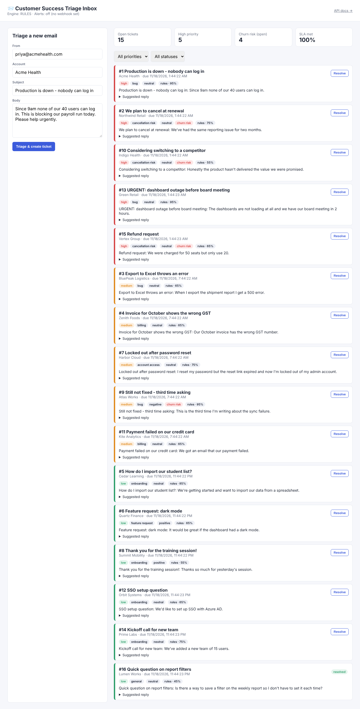

# AI Customer Email Triage API

A production-style FastAPI service that reads inbound customer emails, uses an LLM to classify each one by **priority, category, sentiment and churn risk**, drafts a first reply, tracks it as a ticket with an **SLA**, and sends an **instant Google Chat / Slack alert** for anything urgent.

It grew out of an n8n email-triage workflow I built at work. This version turns it into a tested, deployable service with a fallback engine, SLA tracking and reporting, and it can still be driven by n8n (workflow included).

     

---

## Why

Customer Success inboxes mix outage reports, cancellation threats, billing questions and thank-you notes. When everything sits in one queue, the email that says *"we're evaluating a competitor"* can wait a day behind ten how-to questions. This service makes sure the right email gets seen first and the account owner knows within minutes.



## How it works

```
 Gmail / n8n / any client
          │  POST /tickets
          ▼
 ┌──────────────────────┐   OpenAI key set?   ┌───────────────────┐
 │  Triage engine        │ ──── yes ─────────▶ │ LLM classifier    │──┐
 │                       │                     │ (JSON mode)       │  │ error / bad JSON
 │                       │ ──── no ──────────▶ │ Rule classifier   │◀─┘
 └──────────────────────┘                      └───────────────────┘
          │ priority · category · sentiment · churn risk · summary · draft reply
          ▼
 ┌──────────────────────┐        high / medium        ┌──────────────────────┐
 │ Ticket DB + SLA timer │ ──────────────────────────▶ │ Google Chat / Slack  │
 └──────────────────────┘                              └──────────────────────┘
          │
          ▼
 Work queue · status updates · SLA & churn-risk stats · web inbox
```

| Priority | Examples | SLA |
|---|---|---|
| 🔴 High | outage, all users blocked, deadline today, cancellation or competitor threat | 2 h |
| 🟠 Medium | bug affecting some users, access or billing issue, unhappy customer | 8 h |
| 🟢 Low | how-to, onboarding, feature request, thank-you | 24 h |

**Categories:** `cancellation_risk`, `bug`, `billing`, `onboarding`, `feature_request`, `account_access`, `general`

### Key design choices

- **Two engines, one contract.** The LLM is asked for strict JSON and the response is validated with Pydantic. If the API is down, rate-limited or returns invalid values, the request automatically falls back to the rule engine, so triage never fails.
- **Explainable.** Every result includes `reasons` (e.g. *"urgency words: down, blocking"*) and a confidence score.
- **Safe replies.** The prompt forbids promising refunds, discounts or fix dates in drafted replies.
- **Alerts never break the request.** Webhook failures are logged and recorded (`alert_sent: false`).

## Accuracy

`samples/emails.json` holds 16 hand-labelled customer emails. Run `python -m scripts.evaluate --rules`:

| Engine | Priority accuracy | Category accuracy |
|---|---|---|
| Rule-based (offline) | 100% (16/16) | 88% (14/16) |

The rule engine misses nuance, for example a "thank you for the training" email gets tagged as onboarding. That's the gap the LLM engine is there to close. Run `python -m scripts.evaluate` with an `OPENAI_API_KEY` set to measure the LLM on the same set.

## Quick start

```bash
git clone https://github.com/Kowshikhvarma/ai-ticket-triage-api.git
cd ai-ticket-triage-api
python -m venv .venv && source .venv/bin/activate      # Windows: .venv\Scripts\activate
pip install -r requirements.txt

cp .env.example .env          # optional: add OPENAI_API_KEY and CHAT_WEBHOOK_URL
uvicorn app.main:app --reload
```

- Web inbox: http://localhost:8000
- Interactive API docs (Swagger): http://localhost:8000/docs

Run tests:

```bash
pytest
```

Or with Docker:

```bash
docker build -t triage-api .
docker run -p 8000:8000 --env-file .env -v triage-data:/data triage-api
```

## API

| Method | Endpoint | Description |
|---|---|---|
| `POST` | `/tickets` | Triage an email, store it, alert if high/medium |
| `POST` | `/tickets/batch` | Up to 100 emails at once |
| `POST` | `/triage/preview` | Classify without saving |
| `GET` | `/tickets` | Work queue sorted by priority, then age. Filters: `priority`, `category`, `status`, `churn_risk` |
| `GET` | `/tickets/{id}` | One ticket |
| `PATCH` | `/tickets/{id}` | Update status (`open`, `in_progress`, `resolved`) |
| `GET` | `/stats` | Counts by priority/category/sentiment, open churn risks, SLA breaches, SLA met % |
| `GET` | `/health` | Which engine is active and whether alerts are on |

Example:

```bash
curl -X POST localhost:8000/tickets -H "Content-Type: application/json" -d '{
  "sender": "cfo@northwind.in",
  "account_name": "Northwind Retail",
  "subject": "We plan to cancel at renewal",
  "body": "Unless the reporting issue is fixed we will not renew and are evaluating an alternative."
}'
```

```json
{
  "id": 1,
  "priority": "high",
  "category": "cancellation_risk",
  "churn_risk": true,
  "sla_hours": 2,
  "summary": "We plan to cancel at renewal: Unless the reporting issue is fixed we will not renew ...",
  "suggested_reply": "Hi Northwind Retail team, Thank you for being candid with us...",
  "alert_sent": true,
  "status": "open"
}
```

Set `TRIAGE_API_KEY` to require an `X-API-Key` header on every endpoint.

## Connect it to Gmail with n8n

1. In n8n, **Import from file** → `n8n/gmail_to_triage_workflow.json`
2. Add your Gmail credentials to the **New client email** trigger
3. Set `TRIAGE_API_URL` (and `TRIAGE_API_KEY` if used) as n8n environment variables
4. Activate: every new email becomes a triaged ticket, and urgent ones ping Google Chat

## Project structure

```
ai-ticket-triage-api/
├── app/
│   ├── main.py          # FastAPI routes, ticket creation, SLA, stats
│   ├── classifier.py    # LLM + rule-based engines with automatic fallback
│   ├── notifier.py      # Google Chat / Slack webhook alerts
│   ├── db.py            # SQLAlchemy ticket model
│   ├── schemas.py       # Pydantic request/response models
│   ├── config.py        # environment settings
│   └── static/index.html  # web inbox UI
├── samples/emails.json  # 16 labelled test emails
├── scripts/evaluate.py  # accuracy report
├── n8n/                 # importable n8n workflow
├── tests/               # 17 pytest tests (LLM calls mocked)
└── Dockerfile
```

## Tech stack

Python · FastAPI · Pydantic · SQLAlchemy · OpenAI API · httpx · n8n · Google Chat webhooks · Docker · pytest · HTML/CSS/JavaScript

## Author

**Kowshikh Varma Balerao**, Customer Success Manager · [LinkedIn](https://www.linkedin.com/) · kowshikhvarma@gmail.com
